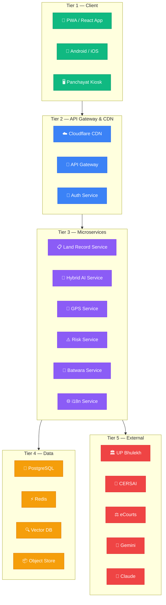
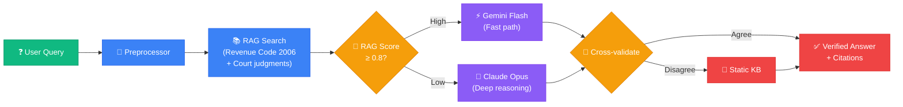
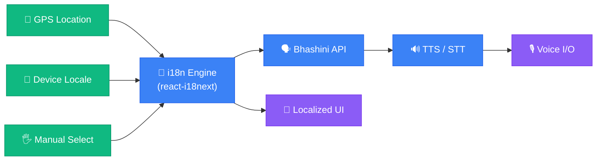
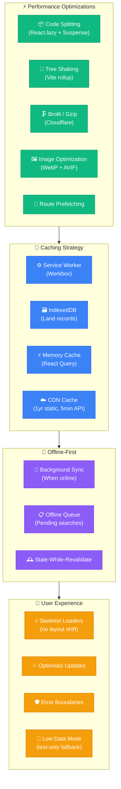
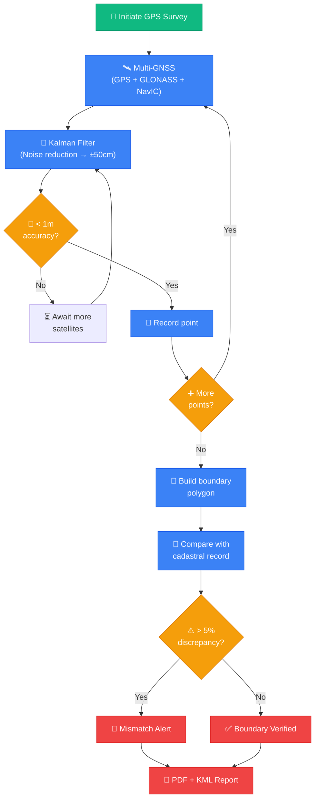
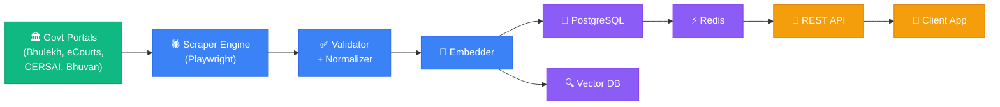

# 🏛️ BhumiCheck — Enterprise Technical Architecture

> **India's Land Intelligence & Demarcation Platform**
> *Replacing Patwari friction with AI precision — for 300M rural stakeholders*

---

## 📋 Table of Contents

- [A. Executive Summary](#a-executive-summary)
- [B. Current State Analysis](#b-current-state-analysis)
- [C. Enterprise Architecture](#c-enterprise-architecture)
- [D. Multi-Language Localization System](#d-multi-language-localization-system)
- [E. Light Mode & User-Friendly Design System](#e-light-mode--user-friendly-design-system)
- [F. Competitive Moat & Sales Strategy](#f-competitive-moat--sales-strategy)
- [G. Phased Delivery Roadmap](#g-phased-delivery-roadmap)
- [H. Technology Decision Matrix](#h-technology-decision-matrix)
- [I. API Specification](#i-api-specification)
- [J. Risk Mitigation](#j-risk-mitigation)

---

## A. Executive Summary

### Project: BhumiCheck 🌾

| Attribute | Detail |
|---|---|
| **Product Name** | BhumiCheck (भूमिचेक) |
| **Vision** | Replace manual Patwari / Lekhpal / Amin / Tehsildar processes with AI-powered land intelligence |
| **Mission** | Make accurate land verification accessible to every Indian in their own language |
| **Target Users** | 300M+ rural and semi-urban land-owning households across India |
| **Primary Market** | Uttar Pradesh (75 districts, 75K+ villages, 100M+ land records) |
| **Tech Lineage** | Evolved from Bhu-Sathi UP (React SPA) → BhumiCheck (Enterprise Multi-State Platform) |

### Unique Selling Propositions (USPs)

| # | USP | Why Unique |
|---|---|---|
| 1 | **Single-view land intelligence** | Owner + Lien + Disputes + GPS boundary in one screen |
| 2 | **AI dispute risk score** | Gemini + Claude RAG hybrid — zero hallucination |
| 3 | **GPS demarcation (±50cm)** | Multi-GNSS + Kalman filter — matches government survey accuracy |
| 4 | **Private family division** | Batwara planning tool — no competitor has this |
| 5 | **Rural-first (2G/offline)** | PWA with < 3s load on 3G — designed for Bharat, not India |
| 6 | **22-language support** | State-wise auto-detection + Bhashini API integration |
| 7 | **Voice-first UI** | "भूमि जांचो" voice command — for semi-literate users |

### Strategic Goals (3-Year)

```
Year 1: 500K MAU · UP only · ₹1.2 crore ARR
Year 2: 5M MAU · 5 states · ₹22 crore ARR
Year 3: 25M MAU · Pan-India · ₹180 crore ARR
```

---

## B. Current State Analysis

### B.1 Existing Codebase: Bhu-Sathi UP

The current application (`index.tsx`, ~850 lines) is a **single-file React SPA** serving as the foundation for BhumiCheck.

#### Component Inventory

| Component | Lines (approx.) | Current Role | BhumiCheck Evolution |
|---|---|---|---|
| `App` | Root | Global state, routing | → Multi-page React Router app |
| `Header` | ~40 | Navigation, branding | → Responsive header with language switcher |
| `VerificationPanel` | ~200 | District/Tehsil/Village/Khata search | → Multi-state search with live API |
| `MapSection` | ~300 | Leaflet map, cadastral, measure, batwara | → GPS demarcation, satellite tiles |
| `ResourceHub` | ~60 | Static links to UP resources | → Dynamic content by state |
| `AIAssistant` | ~150 | Gemini chat | → RAG + Claude hybrid, voice I/O |

#### Current Technology Stack

```
Frontend:  React 19 + TypeScript
Build:     Vite 6
Styling:   Tailwind CSS (CDN-based inline classes)
Mapping:   Leaflet + React-Leaflet
AI:        Google Gemini API (@google/genai)
Icons:     Lucide React
Data:      Static UP_DATA hierarchy (District → Tehsil → Village)
Auth:      None
Backend:   None (client-only SPA)
i18n:      None
State:     UP only
Deploy:    Vite dev server
```

#### Current Limitations

| Limitation | Impact | Priority Fix |
|---|---|---|
| No backend / API | Cannot scale data; mock only | 🔴 Critical |
| No authentication | No personalization, no Pro tier | 🔴 Critical |
| No i18n | Only English UI | 🔴 Critical |
| Single state (UP) | Cannot expand to other states | 🔴 Critical |
| Mock data only | Results not real | 🔴 Critical |
| CDN-based Tailwind | Cannot tree-shake, slow on 2G | 🟡 High |
| No offline support | Fails without internet | 🟡 High |
| No GPS demarcation | Key feature missing | 🟡 High |
| Single AI (Gemini) | Hallucination risk | 🟡 High |
| No test coverage | Regression risk | 🟠 Medium |

### B.2 Migration Path

```
Bhu-Sathi (Single-file SPA)
    ↓ Phase 1
BhumiCheck MVP (Modular React + FastAPI backend + Real UP data)
    ↓ Phase 2
Multi-state + AI + RAG + Voice
    ↓ Phase 3
GPS + Maps + PWA + Offline
    ↓ Phase 4
Family Division + Privacy + Reports
    ↓ Phase 5
Pan-India + Payment + Enterprise API
    ↓ Phase 6
Public Launch + Marketing
```

---

## C. Enterprise Architecture

### C.1 Master System Architecture

The BhumiCheck enterprise platform follows a **5-tier architecture**:



### C.2 Hybrid AI Engine

The Hybrid AI Engine prevents hallucination through cross-validation between Gemini and Claude, backed by a RAG knowledge base of Indian revenue law:



**Decision Matrix for AI Routing:**

| Signal | Gemini | Claude | Fallback KB |
|---|---|---|---|
| Simple factual query | ✅ Primary | ❌ | ❌ |
| Complex legal interpretation | ✅ Draft | ✅ Verify | ❌ |
| RAG confidence < 0.5 | ❌ | ✅ Primary | ❌ |
| Both models disagree | ❌ | ❌ | ✅ |
| API timeout / error | ✅ Retry | ✅ Retry | ✅ Fallback |

### C.3 Multi-Language System



**State-to-Language Mapping:**

| State | Primary Language | Script | ISO Code |
|---|---|---|---|
| Uttar Pradesh, Uttarakhand, Bihar, MP | Hindi | Devanagari | `hi` |
| Tamil Nadu | Tamil | Tamil | `ta` |
| West Bengal | Bengali | Bengali | `bn` |
| Andhra Pradesh, Telangana | Telugu | Telugu | `te` |
| Karnataka | Kannada | Kannada | `kn` |
| Kerala | Malayalam | Malayalam | `ml` |
| Gujarat | Gujarati | Gujarati | `gu` |
| Maharashtra | Marathi | Devanagari | `mr` |
| Punjab | Punjabi | Gurmukhi | `pa` |
| Odisha | Odia | Odia | `or` |
| Jammu & Kashmir | Urdu | Nastaliq (RTL) | `ur` |
| Assam | Assamese | Bengali | `as` |
| All states (fallback) | English | Latin | `en` |

### C.4 Light Mode & Performance Architecture



**Performance Budget:**

| Metric | Target (3G) | Target (4G) | Measurement Tool |
|---|---|---|---|
| First Contentful Paint | < 1.8s | < 0.8s | Lighthouse |
| Time to Interactive | < 3.0s | < 1.2s | Lighthouse |
| Total Bundle (JS) | < 150KB gzipped | < 150KB | Vite Bundle Analyzer |
| Total Bundle (CSS) | < 20KB | < 20KB | PurgeCSS |
| Largest Contentful Paint | < 2.5s | < 1.0s | Core Web Vitals |
| Cumulative Layout Shift | < 0.1 | < 0.1 | Core Web Vitals |
| First Input Delay | < 100ms | < 50ms | Core Web Vitals |

### C.5 GPS Demarcation Flow



### C.6 Security & Privacy Architecture

BhumiCheck is **DPDP Act 2023 compliant by design**:

| Layer | Control | Implementation |
|---|---|---|
| **Network** | TLS 1.3, WAF, DDoS protection | Cloudflare Enterprise |
| **Authentication** | OTP + Aadhaar eKYC optional | JWT (15-min TTL) + Refresh |
| **Authorization** | RBAC: Citizen / Surveyor / Officer / Admin | Custom middleware |
| **Data at Rest** | AES-256 encryption | PostgreSQL + pgcrypto |
| **PII Fields** | Field-level encryption (Aadhaar, Mobile) | Application-layer encryption |
| **Audit** | Immutable audit log (every data access) | Append-only table + S3 archive |
| **DPDP 2023** | Consent management, Right to erasure | Consent DB + deletion workflows |
| **Penetration Testing** | Quarterly external pentest | CERT-In empanelled firm |

### C.7 Deployment Architecture

**Cloud:** AWS Mumbai (ap-south-1) primary + GCP Mumbai failover
**Container:** Docker + Kubernetes (EKS)
**IaC:** Terraform (all infra as code)
**CI/CD:** GitHub Actions + ArgoCD (GitOps)

```
Production:  3x API pods + 2x AI pods + 2x GPS pods (HPA enabled)
Staging:     1x each pod (cost-optimized)
Data:        PostgreSQL Multi-AZ + Redis Cluster (3-node) + Pinecone
CDN:         Cloudflare (global) — static assets cached 1 year
```

### C.8 Data Flow Diagram



### C.9 Monetization Architecture

| Tier | Price | Key Gate | Revenue Model |
|---|---|---|---|
| 🌾 Free | ₹0 | 5 searches/day | Funnel to Pro; ad-supported (optional) |
| ⭐ Pro | ₹99/month | Unlimited search + lien + AI | Monthly SaaS |
| 🔭 Surveyor | ₹499/month | GPS demarcation + all states | Monthly SaaS |
| 🏢 Enterprise | Custom (₹5L+/yr) | API access + white-label | Annual contract |
| 🏦 B2B API | ₹5–50/query | Per-verification (banks) | Pay-per-use |
| 📋 Reports | ₹200–500/report | Certified PDF (courts) | Transactional |

---

## D. Multi-Language Localization System

### D.1 Architecture Overview

```
/docs/i18n/
├── en.json       (English — Latin script)
├── hi.json       (Hindi — Devanagari)
├── ta.json       (Tamil — Tamil script)
├── bn.json       (Bengali — Bengali script)
├── te.json       (Telugu — Telugu script)
├── kn.json       (Kannada — Kannada script)
├── ml.json       (Malayalam — Malayalam script)
├── gu.json       (Gujarati — Gujarati script)
├── mr.json       (Marathi — Devanagari)
├── pa.json       (Punjabi — Gurmukhi)
├── or.json       (Odia — Odia script)
├── ur.json       (Urdu — Nastaliq RTL)
└── as.json       (Assamese — Bengali script)
```

### D.2 Language File Structure

Each `{lang}.json` follows this standardized schema (see `docs/i18n/en.json` and `docs/i18n/hi.json` for full examples):

```json
{
  "_meta": { "lang": "...", "script": "...", "direction": "ltr|rtl" },
  "app": { "name": "...", "tagline": "..." },
  "nav": { "home": "...", "verify": "...", ... },
  "search": { "title": "...", "placeholder_district": "...", ... },
  "land_record": { "khata_number": "...", "owner_name": "...", ... },
  "risk": { "low": "...", "high": "...", "lien_detected": "...", ... },
  "map": { "cadastral_view": "...", "gps_demarcation": "...", ... },
  "ai_assistant": { "title": "...", "placeholder": "...", ... },
  "errors": { "network_error": "...", "not_found": "...", ... },
  "buttons": { "ok": "...", "cancel": "...", "search": "...", ... }
}
```

### D.3 Auto-Detection Logic

```typescript
// Priority order for language selection
function detectLanguage(): string {
  // 1. User's saved preference (localStorage)
  const saved = localStorage.getItem('bhumicheck_lang');
  if (saved) return saved;

  // 2. GPS-based state detection → language mapping
  const state = detectStateFromGPS();
  if (state) return STATE_LANG_MAP[state];

  // 3. Device locale
  const deviceLang = navigator.language.split('-')[0];
  if (SUPPORTED_LANGS.includes(deviceLang)) return deviceLang;

  // 4. Default fallback
  return 'hi'; // Hindi for India-first
}
```

### D.4 Bhashini API Integration

The [Bhashini API](https://bhashini.gov.in/) (MeitY initiative) provides:
- **Real-time translation** between 22 Indian languages
- **ASR (Speech-to-Text)** for Indian accented speech
- **TTS (Text-to-Speech)** for 22 languages
- **NMT (Neural Machine Translation)** with domain-specific land record vocabulary

```typescript
// Example: Translate UI text via Bhashini
async function translate(text: string, targetLang: string): Promise<string> {
  const response = await fetch('https://dhruva-api.bhashini.gov.in/services/inference/pipeline', {
    method: 'POST',
    headers: { 'Authorization': BHASHINI_API_KEY },
    body: JSON.stringify({
      pipelineTasks: [{ taskType: 'translation', config: { language: { targetLanguage: targetLang } } }],
      inputData: { input: [{ source: text }] }
    })
  });
  return response.json().then(r => r.pipelineResponse[0].output[0].target);
}
```

### D.5 Voice-First UI

For semi-literate and illiterate users:

| Feature | Implementation | Languages |
|---|---|---|
| Voice search | Web Speech API → Bhashini STT | 22 Indian languages |
| Voice output | Bhashini TTS | 22 Indian languages |
| Voice commands | "भूमि जांचो" → triggers search | Hindi + regional |
| Phonetic input | Transliteration input for Devanagari | Hindi, Marathi, Nepali |
| Number reading | Numeric land area read aloud | All languages |

### D.6 Script & RTL Support

| Script | Languages | RTL? | Font |
|---|---|---|---|
| Devanagari | Hindi, Marathi, Sanskrit | No | Noto Sans Devanagari |
| Tamil | Tamil | No | Noto Sans Tamil |
| Bengali | Bengali, Assamese | No | Noto Sans Bengali |
| Telugu | Telugu | No | Noto Sans Telugu |
| Kannada | Kannada | No | Noto Sans Kannada |
| Malayalam | Malayalam | No | Noto Sans Malayalam |
| Gujarati | Gujarati | No | Noto Sans Gujarati |
| Gurmukhi | Punjabi | No | Noto Sans Gurmukhi |
| Odia | Odia | No | Noto Sans Oriya |
| Nastaliq | Urdu | **Yes** | Noto Nastaliq Urdu |

---

## E. Light Mode & User-Friendly Design System

### E.1 Design Philosophy

> **"If a 60-year-old farmer with a ₹5,000 phone and poor eyesight can use it on a sunny day, it's ready."**

### E.2 Color System

```
Light Mode (Default):
  Background:   white (#ffffff)
  Surface:      slate-50 (#f8fafc)
  Primary:      emerald-600 (#059669)
  Accent:       emerald-500 (#10b981)
  Text:         slate-900 (#0f172a)
  Subtext:      slate-600 (#475569)
  Danger:       rose-600 (#e11d48)
  Warning:      amber-500 (#f59e0b)
  Border:       slate-200 (#e2e8f0)

Dark Mode (Optional):
  Background:   slate-950 (#020617)
  Surface:      slate-900 (#0f172a)
  Primary:      emerald-400 (#34d399)
  Text:         slate-50 (#f8fafc)

High Contrast (Outdoor / Sunlight):
  Background:   black (#000000)
  Primary:      yellow (#facc15)
  Text:         white (#ffffff)
  Minimum:      7:1 contrast ratio (WCAG AAA)
```

### E.3 Typography

| Element | Font | Size | Weight |
|---|---|---|---|
| Body text | Noto Sans (auto-script) | 16px (min) | 400 |
| Labels | Noto Sans | 14px (min) | 500 |
| Headings | Noto Sans | 20–32px | 700 |
| Numbers / Data | Noto Sans Mono | 16px | 500 |
| Hindi body | Noto Sans Devanagari | 18px (min) | 400 |

> **Note:** Devanagari requires slightly larger base size (18px vs 16px) for readability.

### E.4 Touch & Accessibility

| Standard | Requirement | Implementation |
|---|---|---|
| WCAG 2.1 AA | Minimum compliance | Automated a11y testing (axe-core) |
| Touch targets | ≥ 48×48px | All buttons, links, dropdowns |
| Focus indicators | 3px offset, 2px border | Custom Tailwind focus ring |
| Screen readers | ARIA labels on all icons | aria-label on every lucide icon |
| Color-blind | Never use color alone | Icon + text for all status indicators |
| Keyboard nav | Full keyboard navigation | tabIndex + keyboard event handlers |

### E.5 Icon-First Navigation

For illiterate users, every action has a universal icon:

| Action | Icon | Text (hidden on mobile) |
|---|---|---|
| Search land | 🔍 magnifying glass | खोजें / Search |
| View map | 🗺️ map | नक्शा / Map |
| GPS survey | 📐 ruler | सीमांकन / Demarcate |
| Family division | 👨‍👩‍👧 family | बँटवारा / Divide |
| AI assistant | 🤖 robot | भू-गुरु / AI Help |
| Download report | 📥 download arrow | रिपोर्ट / Report |
| Risk: low | 🟢 green circle | सुरक्षित / Safe |
| Risk: high | 🔴 red circle | जोखिम / Risk |
| Bank lien | 🏦 bank building | बंधक / Lien |
| Court case | ⚖️ scales | मुकदमा / Case |

### E.6 PWA & Offline Strategy

```
Install Prompt → Add to Home Screen → Offline Mode
                                         ↓
               Service Worker (Workbox 7)
               ├── Cache First: static assets (fonts, icons, JS)
               ├── Network First: API calls (with offline fallback)
               ├── Stale-While-Revalidate: land records (5-min TTL)
               └── Background Sync: pending searches queue
```

**IndexedDB Schema (Offline Storage):**
```
bhumicheck_db:
  ├── recent_searches (last 50)
  ├── saved_records (user bookmarks)
  ├── gps_surveys (offline GPS data)
  └── pending_queries (to sync when online)
```

### E.7 Responsive Breakpoints

| Breakpoint | Width | Target Device |
|---|---|---|
| `xs` | 360px | Budget Android (₹5,000) |
| `sm` | 480px | Mid-range Android |
| `md` | 768px | Tablet / iPad |
| `lg` | 1024px | Laptop |
| `xl` | 1280px | Desktop |
| `2xl` | 1920px | Large monitor |

> Mobile-first: 85%+ of target users are on mobile. Desktop is secondary.

---

## F. Competitive Moat & Sales Strategy

### F.1 Feature Comparison

| Feature | BhumiCheck | Bhulekh.gov.in | LandInsights | NoBroker | 99acres |
|---|---|---|---|---|---|
| Land record search | ✅ | ✅ | ✅ | ❌ | ❌ |
| Bank lien detection | ✅ | ❌ | ⚠️ | ❌ | ❌ |
| Court dispute check | ✅ | ❌ | ❌ | ❌ | ❌ |
| GPS demarcation | ✅ | ❌ | ❌ | ❌ | ❌ |
| AI legal assistant | ✅ | ❌ | ❌ | ⚠️ | ❌ |
| Family Batwara tool | ✅ | ❌ | ❌ | ❌ | ❌ |
| Hindi voice search | ✅ | ❌ | ❌ | ⚠️ | ❌ |
| Offline mode (PWA) | ✅ | ❌ | ❌ | ❌ | ❌ |
| Multi-state support | ✅ | UP only | Limited | ✅ | ✅ |
| Works on 2G | ✅ | ⚠️ | ❌ | ❌ | ❌ |
| 22 Indian languages | ✅ | Hindi + EN | EN only | EN + Hi | EN only |
| Free tier | ✅ | Free (limited) | Paid only | ✅ | ✅ |
| Certified reports | ✅ | ❌ | ✅ | ❌ | ❌ |
| B2B API | ✅ | ❌ | ✅ | ❌ | ❌ |

**Score: BhumiCheck 14/14 vs best competitor 6/14**

### F.2 TAM / SAM / SOM

| Market | Size | Basis |
|---|---|---|
| **TAM** | 300M households | All land-owning households in India |
| **SAM** | 170M households | Target states (UP, MP, Bihar, Raj, TN, MH) |
| **SOM (Y3)** | 8.5M users | 5% penetration of SAM |
| **Paying users (Y3)** | 1.05M | 12.4% conversion to paid tiers |
| **ARR (Y3)** | ₹180 crore | Based on tier ARPU |

### F.3 Pricing Strategy

```
Free ₹0/month    → Build trust, viral growth, data network effect
Pro ₹99/month    → Individual buyers, investors, lawyers (primary revenue)
Surveyor ₹499/mo → Licensed surveyors, patwaris, tahsildars
Enterprise custom → Banks, NBFCs, government departments
```

**Rationale:** ₹99/month is less than one trip to the Tehsil office (₹200–500 including transport + bribe). The value is immediate and quantifiable.

### F.4 Go-to-Market Strategy

| Channel | Target | Tactic | CAC |
|---|---|---|---|
| WhatsApp virality | Rural users | Shareable search result cards | ₹8 |
| YouTube (Hindi) | Farmers + buyers | "जमीन की जाँच" tutorial series | ₹25 |
| Panchayat kiosks | Village users | 5,000 Gram Panchayat deployments | ₹50 |
| Bank partnerships | Loan officers | Free API trial for NBFCs | ₹0 |
| Government pilots | Revenue officers | DILRMP integration | ₹0 |
| Google/Meta ads | Urban land buyers | Targeted property-intent ads | ₹120 |
| CSC (Common Service Centres) | Rural users | ₹20 per search at CSC | ₹30 |

### F.5 Revenue Projections (3-Year)

| Metric | Year 1 | Year 2 | Year 3 |
|---|---|---|---|
| Free MAU | 500K | 5M | 25M |
| Pro subscribers | 10K | 150K | 1M |
| Surveyor subscribers | 500 | 5K | 50K |
| Enterprise clients | 10 | 50 | 200 |
| B2B API (calls/month) | 100K | 2M | 20M |
| Report sales | 1K | 20K | 200K |
| **Total Revenue** | **₹1.2 Cr** | **₹22 Cr** | **₹180 Cr** |
| Gross Margin | 65% | 72% | 78% |
| EBITDA | -₹3 Cr | ₹2 Cr | ₹45 Cr |

### F.6 Partnership Pipeline

| Partner | Type | Value | Timeline |
|---|---|---|---|
| DILRMP (MeitY) | Data API | 50-state land data access | Month 6 |
| UP Revenue Dept | Pilot | 1M verified records, govt endorsement | Month 4 |
| HDFC / SBI / Bandhan Bank | B2B API | 100K verifications/month at ₹20/query | Month 9 |
| NIC (National Informatics Centre) | Technical | Infrastructure + eCourts API access | Month 8 |
| Housing.com / MagicBricks | Data partnership | Embed in property listing pages | Month 18 |
| IRDAI / insurance companies | New vertical | Land-backed insurance verification | Month 24 |

---

## G. Phased Delivery Roadmap

### Phase 1: Foundation + UP MVP (Weeks 1–8)

| Week | Milestone | Deliverables |
|---|---|---|
| 1–2 | Project setup | Monorepo, CI/CD, Kubernetes cluster, dev environments |
| 3–4 | Backend foundation | FastAPI + PostgreSQL, Auth service, UP data ingestion |
| 5–6 | Frontend migration | React Router, component split from `index.tsx`, Tailwind purge |
| 7–8 | UP MVP launch | Live UP land records, basic risk flags, Hindi UI |

**Exit Criteria:** 1,000 real UP land records searchable, < 2s response time

### Phase 2: AI + RAG + Multi-Language (Weeks 9–16)

| Week | Milestone | Deliverables |
|---|---|---|
| 9–10 | AI infrastructure | Vector DB, RAG pipeline, UP Revenue Code 2006 indexed |
| 11–12 | Hybrid AI engine | Gemini + Claude cross-validation, confidence scoring |
| 13–14 | Bhu-Guru AI assistant | Voice input, Hindi + English, RAG-grounded answers |
| 15–16 | Multi-language | react-i18next, Bhashini integration, 5 languages live |

**Exit Criteria:** AI answers < 5s, hallucination rate < 2%, 5 languages working

### Phase 3: GPS + Maps + Light Mode (Weeks 17–22)

| Week | Milestone | Deliverables |
|---|---|---|
| 17–18 | GPS demarcation | Multi-GNSS, Kalman filter, boundary polygon |
| 19–20 | Cadastral map overlay | ISRO Bhuvan tiles, record overlay, mismatch detection |
| 21–22 | PWA + offline | Service worker, IndexedDB, background sync, < 3s on 3G |

**Exit Criteria:** GPS accuracy ±1m, offline search from cache working

### Phase 4: Family Division + Privacy (Weeks 23–28)

| Week | Milestone | Deliverables |
|---|---|---|
| 23–24 | Batwara tool | Polygon split algorithm, visual division map |
| 25–26 | Report generation | PDF reports, KML export, certified report workflow |
| 27–28 | Privacy + DPDP | Consent management, Right to erasure, audit log |

**Exit Criteria:** Batwara PDF generated, DPDP 2023 compliance audit pass

### Phase 5: Multi-State + Payment (Weeks 29–36)

| Week | Milestone | Deliverables |
|---|---|---|
| 29–30 | Bihar + MP expansion | State scrapers, data normalization, 2 new states |
| 31–32 | Rajasthan + Maharashtra | 2 more states, regional language support |
| 33–34 | Payment integration | Razorpay, UPI, Pro/Surveyor tiers, GST invoicing |
| 35–36 | B2B API | API gateway, developer portal, bank onboarding |

**Exit Criteria:** 5 states live, first paying customer, B2B API docs published

### Phase 6: Public Launch (Weeks 37–44)

| Week | Milestone | Deliverables |
|---|---|---|
| 37–38 | Mobile app | React Native (code-share 80%), Play Store submission |
| 39–40 | Marketing launch | YouTube series (10 Hindi videos), WhatsApp campaigns |
| 41–42 | Panchayat program | 500 Panchayat kiosks deployed in UP |
| 43–44 | Scale testing | Load testing 100K concurrent, SLA 99.9% target |

**Exit Criteria:** 100K MAU, Play Store rating > 4.0, 99.9% uptime

### Phase 7: Growth & Scale (2027+)

- Pan-India expansion (all 28 states + 8 UTs)
- AI model fine-tuning on Indian land law
- IPO preparation (₹500+ crore ARR target)
- International expansion (Bangladesh, Nepal, Sri Lanka)
- Land insurance vertical
- Blockchain-based land title registry pilot

---

## H. Technology Decision Matrix

| Decision | Choice | Rationale | Alternatives Considered |
|---|---|---|---|
| **Frontend Framework** | React 19 (TypeScript) | Existing codebase; largest ecosystem; team familiarity | Next.js (SSR not needed for SPA), Vue 3 |
| **Build Tool** | Vite 6 | Existing; fastest HMR; excellent code splitting | Webpack 5, esbuild, Parcel |
| **Styling** | Tailwind CSS (installed, not CDN) | Utility-first, tree-shakeable, existing team knowledge | CSS Modules, Styled Components |
| **Mapping** | Leaflet + React-Leaflet | Existing; lightweight (39KB); free tile options | Mapbox GL ($$), Google Maps ($$), Deck.gl |
| **Backend** | FastAPI (Python) | Fastest Python API; async; ideal for AI integrations | Express.js, Django, NestJS |
| **Database** | PostgreSQL + pgvector | ACID compliance; vector search native; JSONB for flexibility | MongoDB, MySQL, CockroachDB |
| **Cache** | Redis 7 | Industry standard; Pub/Sub for GPS streams | Memcached, Hazelcast |
| **AI — Fast** | Google Gemini Flash | Low latency (< 1s); existing Gemini key in codebase | OpenAI GPT-4o-mini, Mistral |
| **AI — Deep** | Anthropic Claude Opus | Best legal reasoning; low hallucination | OpenAI GPT-4o, Gemini Ultra |
| **Vector DB** | pgvector (PostgreSQL ext) | No separate service; adequate for < 10M vectors | Pinecone ($$), Weaviate, Chroma |
| **i18n** | react-i18next | Standard; lazy loading; Bhashini-compatible | react-intl, LinguiJS |
| **Translation API** | Bhashini (MeitY) | Free for Indian languages; government-backed; 22 languages | Google Translate ($$), DeepL |
| **Maps Tiles** | ISRO Bhuvan + OSM | Free; India-optimized; cadastral data available | Google Maps ($$), Mapbox ($$) |
| **Auth** | JWT + OTP (Twilio) | Stateless; mobile OTP standard in India | Aadhaar-based, OAuth2 (limited rural use) |
| **Payments** | Razorpay | India-first; UPI native; GST compliant | PayU, CCAvenue, Stripe (no UPI) |
| **Container** | Docker + Kubernetes (EKS) | Industry standard; auto-scaling; AWS Mumbai native | ECS, VM-based, GKE |
| **CDN** | Cloudflare | Best performance in India; free DDoS; Workers | AWS CloudFront, Fastly |
| **Monitoring** | Datadog + Sentry | Industry standard; APM + error tracking combo | New Relic, Grafana+Prometheus |
| **CI/CD** | GitHub Actions + ArgoCD | Native to GitHub; GitOps best practice | Jenkins, CircleCI, Tekton |
| **Service Worker** | Workbox 7 | Google-maintained; best PWA tooling | Manual SW, sw-precache |

---

## I. API Specification

### I.1 Base URL & Versioning

```
Production:  https://api.bhumicheck.in/v1
Staging:     https://api-staging.bhumicheck.in/v1
Local dev:   http://localhost:8000/v1
```

All responses follow:
```json
{
  "success": true,
  "data": { ... },
  "meta": { "request_id": "uuid", "version": "1.0" },
  "error": null
}
```

### I.2 Authentication

```http
POST /v1/auth/otp/send
Content-Type: application/json

{ "mobile": "+919876543210" }

---

POST /v1/auth/otp/verify
{ "mobile": "+919876543210", "otp": "123456" }

Response:
{ "access_token": "jwt...", "refresh_token": "jwt...", "expires_in": 900 }
```

### I.3 Land Records API

```http
# Search land records
GET /v1/land/search?district=Basti&tehsil=Basti+Sadar&village=Mohammadpur&khata=123
Authorization: Bearer {token}

Response:
{
  "success": true,
  "data": {
    "records": [{
      "id": "uuid",
      "khata_number": "123",
      "gata_numbers": ["45A", "45B"],
      "owners": [{ "name_hi": "रामप्रसाद", "share_percent": 100 }],
      "area_hectare": 0.4047,
      "area_bigha": 1.0,
      "land_type": "Agricultural",
      "risk_score": 72,
      "risk_flags": ["LIEN_DETECTED", "MUTATION_PENDING"],
      "last_mutation_date": "2022-03-15",
      "circle_rate_per_sqm": 850
    }]
  }
}

# Get single land record detail
GET /v1/land/records/{record_id}

# Get land history (mutation log)
GET /v1/land/records/{record_id}/history
```

### I.4 Risk Assessment API

```http
GET /v1/risk/{record_id}

Response:
{
  "risk_score": 72,
  "risk_level": "HIGH",
  "flags": [
    {
      "type": "BANK_LIEN",
      "bank": "HDFC Bank",
      "amount": 1500000,
      "cersai_id": "CERSAI2021UP123",
      "lien_date": "2021-06-01"
    },
    {
      "type": "COURT_CASE",
      "case_number": "Civil Suit 234/2019",
      "court": "District Court Basti",
      "status": "PENDING",
      "filing_date": "2019-08-15"
    }
  ],
  "recommendation": "HIGH_RISK_DO_NOT_BUY",
  "ai_summary_hi": "इस भूमि पर बैंक का बंधक और एक लंबित वाद है। खरीदने से पहले कानूनी सलाह लें।"
}
```

### I.5 AI Assistant API

```http
POST /v1/ai/chat
Authorization: Bearer {token}
Content-Type: application/json

{
  "query": "UP में दाखिल-खारिज की प्रक्रिया क्या है?",
  "lang": "hi",
  "context": { "district": "Basti", "record_id": "uuid" }
}

Response:
{
  "answer": "उत्तर प्रदेश में दाखिल-खारिज के लिए...",
  "sources": ["UP Revenue Code 2006, Section 34", "Bhulekh Portal Guide"],
  "confidence": 0.91,
  "ai_engine": "gemini-flash",
  "cross_validated": true
}
```

### I.6 GPS Demarcation API

```http
# Start a GPS survey session
POST /v1/gps/surveys
{ "record_id": "uuid", "device_gnss": ["GPS", "GLONASS", "NAVIC"] }

# Add a boundary point
POST /v1/gps/surveys/{survey_id}/points
{ "lat": 26.8206, "lon": 83.4906, "accuracy_m": 0.45, "altitude_m": 92.3 }

# Close survey and compute boundary
POST /v1/gps/surveys/{survey_id}/complete

Response:
{
  "boundary_polygon": { "type": "Polygon", "coordinates": [[...]] },
  "area_computed_hectare": 0.41,
  "area_record_hectare": 0.4047,
  "mismatch_percent": 1.28,
  "status": "MATCH",
  "report_url": "https://cdn.bhumicheck.in/reports/uuid.pdf"
}
```

### I.7 Batwara (Family Division) API

```http
POST /v1/batwara/plan
{
  "record_id": "uuid",
  "members": [
    { "name_hi": "रामप्रसाद", "share_percent": 40 },
    { "name_hi": "श्यामप्रसाद", "share_percent": 35 },
    { "name_hi": "सीता देवी", "share_percent": 25 }
  ],
  "division_method": "EQUAL_WIDTH"
}

Response:
{
  "division_polygons": [
    { "member_name": "रामप्रसाद", "polygon": {...}, "area_hectare": 0.162 },
    ...
  ],
  "map_preview_url": "https://cdn.bhumicheck.in/batwara/uuid-preview.png",
  "draft_deed_url": "https://cdn.bhumicheck.in/batwara/uuid-deed.pdf"
}
```

### I.8 Rate Limits

| Tier | Searches/day | AI queries/day | GPS surveys/month |
|---|---|---|---|
| Free | 5 | 10 | 0 |
| Pro | Unlimited | 500 | 10 |
| Surveyor | Unlimited | Unlimited | Unlimited |
| Enterprise | Custom | Custom | Custom |

---

## J. Risk Mitigation

### J.1 Technical Risks

| Risk | Probability | Impact | Mitigation |
|---|---|---|---|
| Government portal schema change breaks scrapers | High | High | Versioned adapters + alert on parse failure + 7-day data TTL |
| AI hallucination on legal queries | Medium | High | RAG + cross-validation + mandatory source citation |
| GPS inaccuracy in dense areas | Medium | Medium | Kalman filter + HDOP threshold + user warning |
| Data breach (land records + PII) | Low | Critical | AES-256 + field encryption + audit log + CERT-In pentest |
| Downtime during peak (registration season) | Medium | High | Multi-AZ + Kubernetes HPA + 99.9% SLA target |
| Mobile browser GPS permission denied | High | Medium | Fallback to manual coordinate entry + instructions |

### J.2 Legal & Regulatory Risks

| Risk | Probability | Impact | Mitigation |
|---|---|---|---|
| Government blocks scraper access | Medium | High | Formal data sharing MoU with state revenue departments |
| DPDP 2023 compliance failure | Low | Critical | Legal review + consent management + DPA registration |
| AI providing wrong legal advice | Medium | High | Mandatory disclaimer on every AI response |
| Copyright claim on land records | Low | Medium | Land records are public government data (no copyright) |
| RTI challenge on data accuracy | Low | Medium | Source attribution + disclaimer + data freshness timestamp |

### J.3 Business Risks

| Risk | Probability | Impact | Mitigation |
|---|---|---|---|
| Government launches competing free service | Medium | High | Enterprise features + speed advantage + private Batwara feature |
| Low rural smartphone penetration | Low | Medium | Panchayat kiosk program + CSC integration |
| Difficulty monetizing free users | Medium | Medium | Freemium funnel + B2B API as primary revenue |
| Competitor copies features | High | Medium | Patent GPS + AI combo; network effect moat |
| Funding gap | Low | High | B2B revenue first; bootstrappable to Month 18 |

### J.4 Operational Risks

| Risk | Probability | Impact | Mitigation |
|---|---|---|---|
| Scraper rate limiting by govt portals | High | Medium | Distributed scraping + exponential backoff + caching |
| AI API cost overrun | Medium | Medium | Cost monitoring + caching identical queries + tier limits |
| Rural language model quality | Medium | High | Bhashini API + community feedback loop + domain fine-tuning |
| Team scaling in niche domain | Medium | Medium | Document all domain knowledge + partner with UP revenue lawyers |

---

## 📚 References

- [UP Revenue Code 2006](http://uprevenuecode.gov.in/)
- [Digital India Land Records Modernisation Programme (DILRMP)](https://dilrmp.gov.in/)
- [Bhashini API (MeitY)](https://bhashini.gov.in/)
- [CERSAI (Central Registry of Securitisation Asset Reconstruction and Security Interest)](https://cersai.org.in/)
- [ISRO Bhuvan Geoportal](https://bhuvan.nrsc.gov.in/)
- [eCourts Services](https://ecourts.gov.in/)
- [Digital Personal Data Protection Act 2023](https://www.meity.gov.in/dpdp)
- [NavIC (Navigation with Indian Constellation)](https://www.isro.gov.in/NavIC.html)
- [Existing Bhu-Sathi code: `index.tsx`](../index.tsx)

---

*BhumiCheck Architecture v1.0 — Prepared for engineering team and investors*
*For standalone diagram collection, see [`ARCHITECTURE_DIAGRAMS.md`](./ARCHITECTURE_DIAGRAMS.md)*
*For PDF/Word export instructions, see [`DOWNLOAD_README.md`](./DOWNLOAD_README.md)*
