# 📊 BhumiCheck — Architecture Diagrams

All diagrams use [Mermaid](https://mermaid.js.org) syntax and render natively on GitHub.
Export to PNG/SVG at [mermaid.live](https://mermaid.live).

---

## 1. 🏗️ Master System Architecture

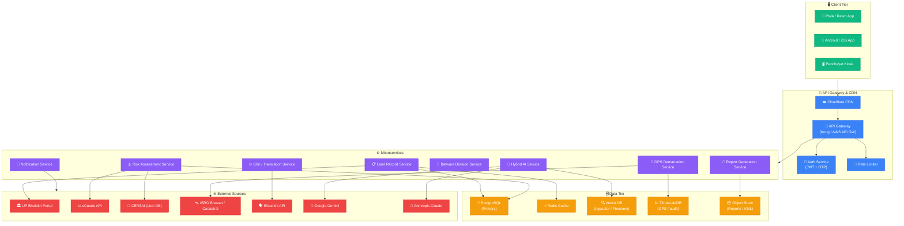

---

## 2. 🤖 Hybrid AI Engine Flow

```mermaid
flowchart LR
    classDef input fill:#10b981,color:#fff,stroke:#059669
    classDef process fill:#3b82f6,color:#fff,stroke:#2563eb
    classDef decision fill:#f59e0b,color:#fff,stroke:#d97706
    classDef ai fill:#8b5cf6,color:#fff,stroke:#7c3aed
    classDef output fill:#ef4444,color:#fff,stroke:#dc2626

    Q["❓ User Query\n(Text / Voice)"]
    PRE["🔄 Preprocessor\n(Language detect,\nentity extraction)"]
    RAG["📚 RAG Pipeline\n(Vector similarity\nsearch)"]
    CONF{"🎯 Confidence\nScore ≥ 0.8?"}
    GEMINI["⚡ Gemini Flash\n(Fast response)"]
    GEMINI_OUT{"✅ Gemini\nConfident?"}
    CLAUDE["🧠 Claude Opus\n(Deep reasoning)"]
    CROSS{"🔀 Cross-validate\n(Both agree?)"}
    FALLBACK["📖 Static KB\n(Revenue Code 2006)"]
    ANSWER["✅ Verified Answer\n+ Source citations"]
    DISCLAIMER["⚠️ Uncertainty\nDisclaimer added"]

    Q --> PRE
    PRE --> RAG
    RAG --> CONF

    CONF -->|"Yes"| GEMINI
    CONF -->|"No"| CLAUDE

    GEMINI --> GEMINI_OUT
    GEMINI_OUT -->|"Yes"| CROSS
    GEMINI_OUT -->|"No"| CLAUDE

    CLAUDE --> CROSS
    CROSS -->|"Agree"| ANSWER
    CROSS -->|"Disagree"| FALLBACK
    FALLBACK --> DISCLAIMER
    DISCLAIMER --> ANSWER

    class Q input
    class PRE,RAG process
    class CONF,GEMINI_OUT,CROSS decision
    class GEMINI,CLAUDE ai
    class ANSWER,DISCLAIMER output
```

---

## 3. 🗺️ User Journey Flowchart

```mermaid
flowchart TD
    classDef start fill:#10b981,color:#fff,stroke:#059669
    classDef action fill:#3b82f6,color:#fff,stroke:#2563eb
    classDef decision fill:#f59e0b,color:#fff,stroke:#d97706
    classDef result fill:#8b5cf6,color:#fff,stroke:#7c3aed
    classDef end fill:#ef4444,color:#fff,stroke:#dc2626

    OPEN["📱 Open BhumiCheck App"]
    LANG{"🌐 First Visit?"}
    SELECT_LANG["🗣️ Select Language\n(Hindi / Regional)"]
    ONBOARD["👋 Quick Onboarding\n(3 icon-steps)"]
    HOME["🏠 Home Screen"]
    VOICE{"🎤 Voice or\nText Input?"}
    VOICE_IN["🎙️ Speak: 'भूमि जांचो'"]
    TEXT_IN["⌨️ Enter District →\nTehsil → Village → Khata"]
    SEARCH["🔍 Search Initiated"]
    FOUND{"📋 Record\nFound?"}
    SHOW_RECORD["📄 Display Record\n(Owner, Area, Type)"]
    RISK["⚠️ Risk Assessment\n(Lien / Dispute / Encumbrance)"]
    RISK_HIGH{"🔴 High Risk?"}
    WARN["🚨 Warning Screen\n+ AI explanation"]
    MAP["🗺️ View on Map\n(Cadastral overlay)"]
    GPS_ASK{"📐 Want GPS\nDemarcation?"}
    GPS["🛰️ Start GPS Survey"]
    COMPARE["📏 Compare Record\nvs Physical Boundary"]
    MISMATCH{"⚡ Boundary\nMismatch?"}
    ALERT["🚨 Mismatch Alert\n+ Report generation"]
    BATWARA_ASK{"🤝 Family\nDivision?"}
    BATWARA["✂️ Batwara Planning\nTool"]
    AI_ASK{"🤖 Legal\nQuestion?"}
    AI["💬 Bhu-Guru AI\nAssistant"]
    DOWNLOAD["📥 Download PDF\nReport"]
    SHARE["📤 Share via\nWhatsApp"]
    NOT_FOUND["❌ Not Found Screen\n+ Helpline number"]

    OPEN --> LANG
    LANG -->|"Yes"| SELECT_LANG
    LANG -->|"No"| HOME
    SELECT_LANG --> ONBOARD
    ONBOARD --> HOME
    HOME --> VOICE
    VOICE -->|"Voice"| VOICE_IN
    VOICE -->|"Text"| TEXT_IN
    VOICE_IN --> SEARCH
    TEXT_IN --> SEARCH
    SEARCH --> FOUND
    FOUND -->|"Yes"| SHOW_RECORD
    FOUND -->|"No"| NOT_FOUND
    SHOW_RECORD --> RISK
    RISK --> RISK_HIGH
    RISK_HIGH -->|"Yes"| WARN
    RISK_HIGH -->|"No"| MAP
    WARN --> MAP
    MAP --> GPS_ASK
    GPS_ASK -->|"Yes"| GPS
    GPS_ASK -->|"No"| BATWARA_ASK
    GPS --> COMPARE
    COMPARE --> MISMATCH
    MISMATCH -->|"Yes"| ALERT
    MISMATCH -->|"No"| BATWARA_ASK
    ALERT --> BATWARA_ASK
    BATWARA_ASK -->|"Yes"| BATWARA
    BATWARA_ASK -->|"No"| AI_ASK
    BATWARA --> AI_ASK
    AI_ASK -->|"Yes"| AI
    AI_ASK -->|"No"| DOWNLOAD
    AI --> DOWNLOAD
    DOWNLOAD --> SHARE

    class OPEN start
    class SELECT_LANG,ONBOARD,TEXT_IN,VOICE_IN,SEARCH,SHOW_RECORD,MAP,GPS,COMPARE,BATWARA,AI,DOWNLOAD,SHARE action
    class LANG,VOICE,FOUND,RISK_HIGH,GPS_ASK,MISMATCH,BATWARA_ASK,AI_ASK decision
    class RISK,WARN,ALERT result
    class NOT_FOUND end
```

---

## 4. 🌐 Multi-Language System

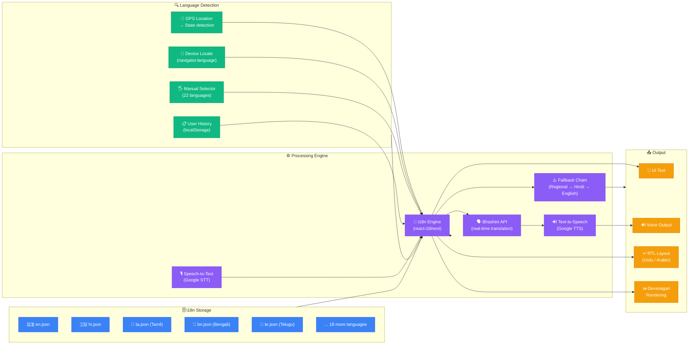

---

## 5. 📐 GPS Demarcation Flow

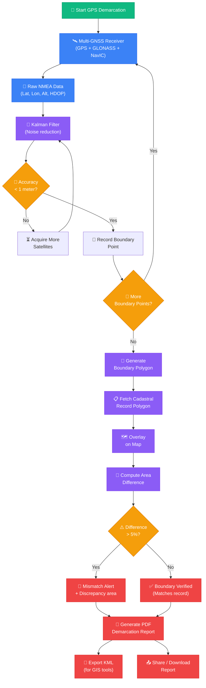

---

## 6. 🔄 Data Flow Diagram

```mermaid
flowchart LR
    classDef source fill:#10b981,color:#fff,stroke:#059669
    classDef scraper fill:#3b82f6,color:#fff,stroke:#2563eb
    classDef transform fill:#8b5cf6,color:#fff,stroke:#7c3aed
    classDef store fill:#f59e0b,color:#fff,stroke:#d97706
    classDef serve fill:#ef4444,color:#fff,stroke:#dc2626

    subgraph SOURCES["🌐 Government Data Sources"]
        BHULEKH_SRC["🏛️ UP Bhulekh\n(upbhulekh.gov.in)"]
        CERSAI_SRC["🏦 CERSAI\n(Mortgage registry)"]
        ECOURTS_SRC["⚖️ eCourts\n(Case database)"]
        BHUVAN_SRC["🛰️ ISRO Bhuvan\n(Cadastral maps)"]
        DILRMP_SRC["🗂️ DILRMP API\n(Central registry)"]
    end

    subgraph SCRAPER["🤖 Data Acquisition"]
        SCRAPER_ENGINE["🕷️ Scraper Orchestrator\n(Playwright + Puppeteer)"]
        API_ADAPTER["🔌 API Adapters\n(REST / SOAP / GraphQL)"]
        QUEUE["📋 Job Queue\n(Bull / Redis)"]
    end

    subgraph TRANSFORM["⚙️ ETL Pipeline"]
        VALIDATOR["✅ Data Validator\n(Schema checks)"]
        NORMALIZER["🔄 Normalizer\n(Devanagari → Unicode)"]
        GEOCODER["🗺️ Geocoder\n(Address → Lat/Lon)"]
        EMBEDDER["🧬 Embedder\n(Text → Vectors)"]
    end

    subgraph STORE["🗄️ Data Storage"]
        PRIMARY_DB["🐘 PostgreSQL\n(Structured records)"]
        VECTOR_STORE["🔍 Vector Store\n(AI knowledge base)"]
        CACHE["⚡ Redis Cache\n(Hot data)"]
        OBJECT_STORE["📦 S3\n(Maps, reports)"]
    end

    subgraph SERVE["📤 Serving Layer"]
        REST_API["🔌 REST API\n(Land records)"]
        AI_API["🤖 AI Inference API\n(Gemini + Claude)"]
        STREAM_API["⚡ WebSocket\n(GPS live stream)"]
    end

    SOURCES --> SCRAPER_ENGINE
    SCRAPER_ENGINE --> API_ADAPTER
    API_ADAPTER --> QUEUE
    QUEUE --> VALIDATOR
    VALIDATOR --> NORMALIZER
    NORMALIZER --> GEOCODER
    GEOCODER --> EMBEDDER
    EMBEDDER --> PRIMARY_DB
    EMBEDDER --> VECTOR_STORE
    PRIMARY_DB --> CACHE
    CACHE --> REST_API
    VECTOR_STORE --> AI_API
    PRIMARY_DB --> STREAM_API

    class BHULEKH_SRC,CERSAI_SRC,ECOURTS_SRC,BHUVAN_SRC,DILRMP_SRC source
    class SCRAPER_ENGINE,API_ADAPTER,QUEUE scraper
    class VALIDATOR,NORMALIZER,GEOCODER,EMBEDDER transform
    class PRIMARY_DB,VECTOR_STORE,CACHE,OBJECT_STORE store
    class REST_API,AI_API,STREAM_API serve
```

---

## 7. 🔒 Security Architecture

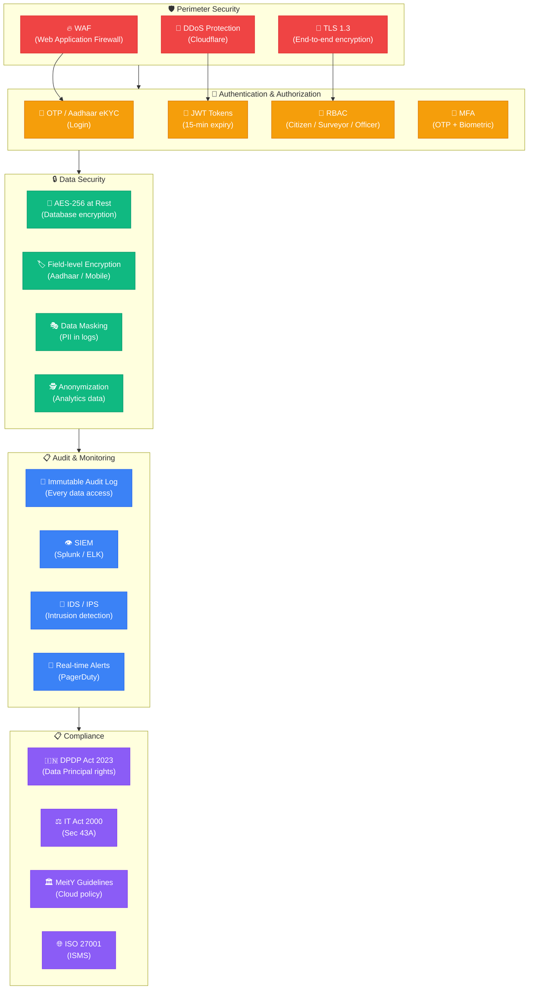

---

## 8. 🚀 Deployment Topology

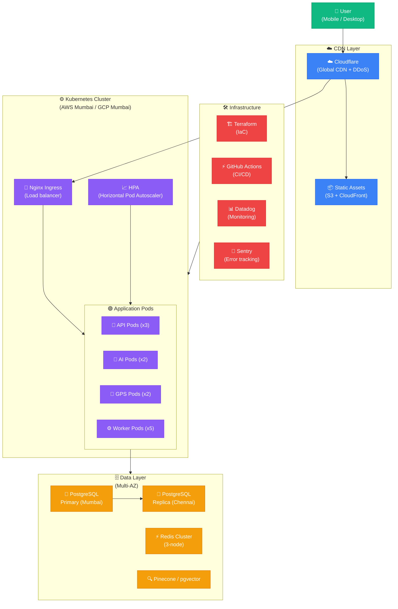

---

## 9. 🔗 Microservice Dependency Graph

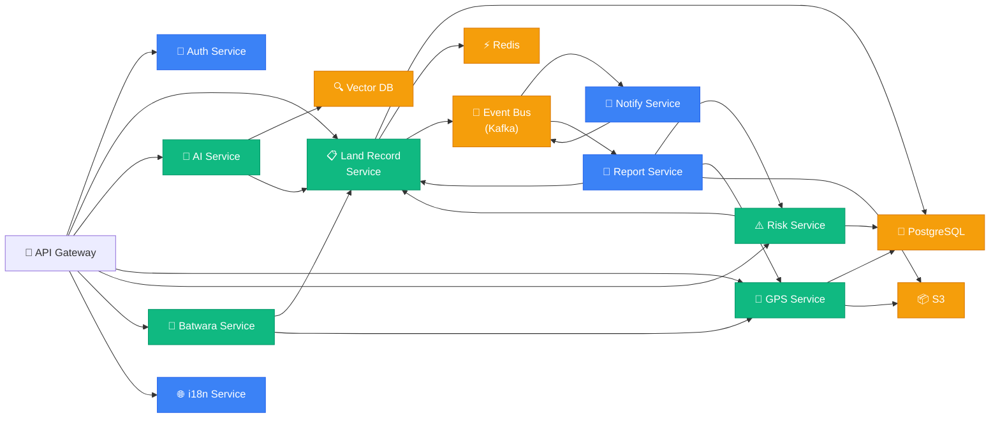

---

## 10. 💳 Monetization & Subscription Flow

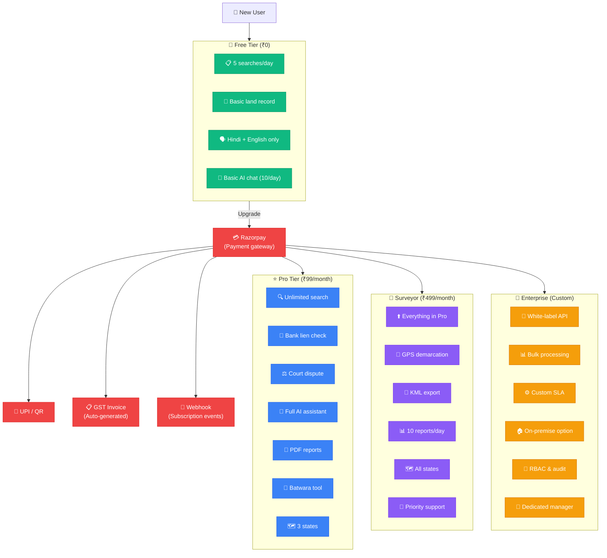

---

## 11. 🕷️ Scraper Orchestration Flow

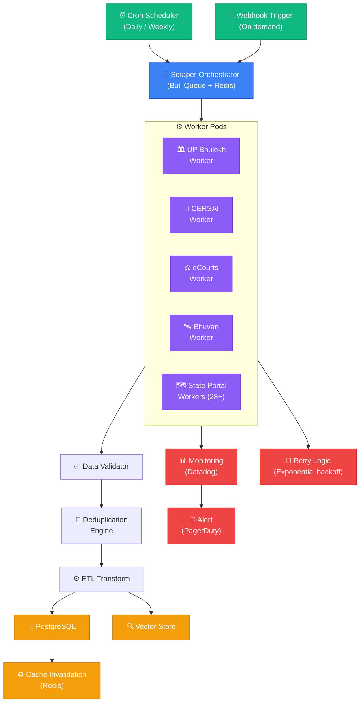

---

## 12. 🧠 RAG Pipeline Detail

```mermaid
flowchart LR
    classDef input fill:#10b981,color:#fff,stroke:#059669
    classDef embed fill:#3b82f6,color:#fff,stroke:#2563eb
    classDef retrieve fill:#8b5cf6,color:#fff,stroke:#7c3aed
    classDef generate fill:#f59e0b,color:#fff,stroke:#d97706
    classDef output fill:#ef4444,color:#fff,stroke:#dc2626

    subgraph INDEXING["📚 Indexing (Offline)"]
        DOCS["📄 Source Documents\n(Revenue Code, Acts,\nCourt Judgments)"]
        CHUNKER["✂️ Text Chunker\n(512 token chunks)"]
        EMBED_MODEL["🧬 Embedding Model\n(text-embedding-004)"]
        VECTOR_INDEX["🔍 Vector Index\n(pgvector / Pinecone)"]
    end

    subgraph RETRIEVAL["🔍 Retrieval (Online)"]
        QUERY["❓ User Query"]
        QUERY_EMBED["🧬 Query Embedding\n(same model)"]
        SIMILARITY["📏 Similarity Search\n(cosine distance, top-5)"]
        RERANK["🏆 Cross-encoder\nReranker"]
        CONTEXT["📋 Relevant Context\n(top-3 chunks)"]
    end

    subgraph GENERATION["✍️ Generation"]
        PROMPT["📝 Prompt Builder\n(Context + Query + System)"]
        LLM["🤖 LLM\n(Gemini / Claude)"]
        POSTPROCESS["🔄 Post-processor\n(Citation extraction,\nLanguage formatting)"]
    end

    RESPONSE["✅ Grounded Response\n+ Source citations"]

    DOCS --> CHUNKER
    CHUNKER --> EMBED_MODEL
    EMBED_MODEL --> VECTOR_INDEX

    QUERY --> QUERY_EMBED
    QUERY_EMBED --> SIMILARITY
    SIMILARITY --> VECTOR_INDEX
    VECTOR_INDEX --> RERANK
    RERANK --> CONTEXT

    CONTEXT --> PROMPT
    QUERY --> PROMPT
    PROMPT --> LLM
    LLM --> POSTPROCESS
    POSTPROCESS --> RESPONSE

    class DOCS,CHUNKER,EMBED_MODEL,VECTOR_INDEX input
    class QUERY,QUERY_EMBED,SIMILARITY,RERANK,CONTEXT retrieve
    class PROMPT,LLM,POSTPROCESS generate
    class RESPONSE output
```

---

## 13. ⚡ CI/CD Pipeline

```mermaid
flowchart LR
    classDef dev fill:#10b981,color:#fff,stroke:#059669
    classDef ci fill:#3b82f6,color:#fff,stroke:#2563eb
    classDef test fill:#8b5cf6,color:#fff,stroke:#7c3aed
    classDef deploy fill:#f59e0b,color:#fff,stroke:#d97706
    classDef monitor fill:#ef4444,color:#fff,stroke:#dc2626

    DEV["👨‍💻 Developer\nPush to branch"]
    PR["🔀 Pull Request\nOpened"]

    subgraph CI["⚙️ CI Pipeline (GitHub Actions)"]
        LINT["🔍 Lint\n(ESLint + Prettier)"]
        TYPE["📝 Type Check\n(tsc --noEmit)"]
        TEST["🧪 Unit Tests\n(Vitest)"]
        BUILD["🏗️ Build\n(Vite)"]
        SECURITY["🔒 Security Scan\n(Snyk + CodeQL)"]
        DOCKER["🐳 Docker Build\n+ Push to ECR"]
    end

    subgraph STAGING["🔬 Staging Deployment"]
        HELM_STAGING["⛵ Helm Deploy\n(staging namespace)"]
        SMOKE["💨 Smoke Tests\n(Playwright)"]
        PERF["📊 Performance\n(Lighthouse CI)"]
    end

    subgraph PROD["🚀 Production Deployment"]
        APPROVAL["👍 Manual Approval\n(Senior Engineer)"]
        HELM_PROD["⛵ Helm Deploy\n(Blue-Green)"]
        HEALTH["❤️ Health Check\n(3-minute window)"]
        ROLLBACK["↩️ Auto-rollback\n(on failure)"]
    end

    subgraph MONITOR_LAYER["📊 Post-Deploy Monitoring"]
        DATADOG["📈 Datadog\n(Metrics)"]
        SENTRY["🐛 Sentry\n(Errors)"]
        PAGER["🔔 PagerDuty\n(Alerts)"]
    end

    DEV --> PR
    PR --> LINT
    LINT --> TYPE
    TYPE --> TEST
    TEST --> BUILD
    BUILD --> SECURITY
    SECURITY --> DOCKER
    DOCKER --> HELM_STAGING
    HELM_STAGING --> SMOKE
    SMOKE --> PERF
    PERF --> APPROVAL
    APPROVAL --> HELM_PROD
    HELM_PROD --> HEALTH
    HEALTH -->|"Healthy"| MONITOR_LAYER
    HEALTH -->|"Unhealthy"| ROLLBACK

    class DEV,PR dev
    class LINT,TYPE,TEST,BUILD,SECURITY,DOCKER ci
    class HELM_STAGING,SMOKE,PERF test
    class APPROVAL,HELM_PROD,HEALTH,ROLLBACK deploy
    class DATADOG,SENTRY,PAGER monitor
```

---

## 14. 🗃️ Database ER Diagram

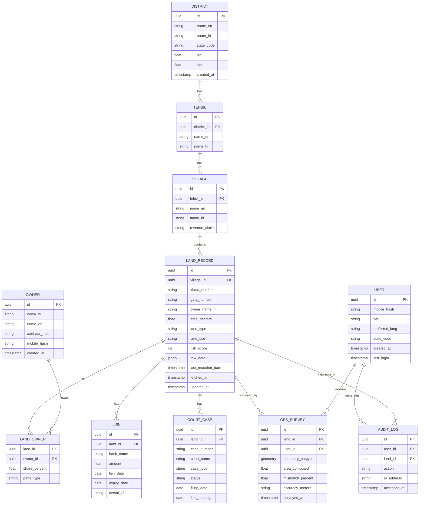

---

## 15. 🔄 State Machine: Land Record Lifecycle

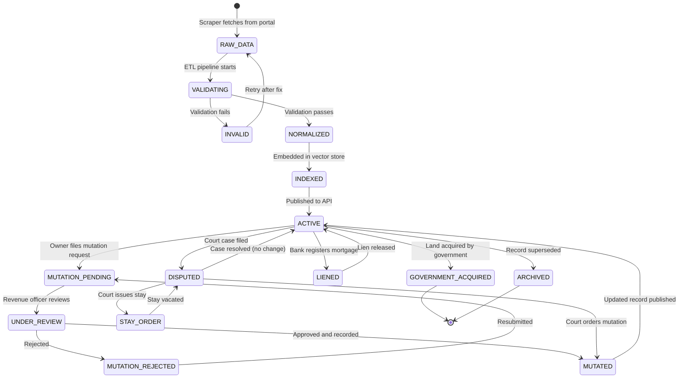

---

*All diagrams render natively on GitHub. Export individual diagrams at [mermaid.live](https://mermaid.live)*

*BhumiCheck — India's Land Intelligence Platform*
